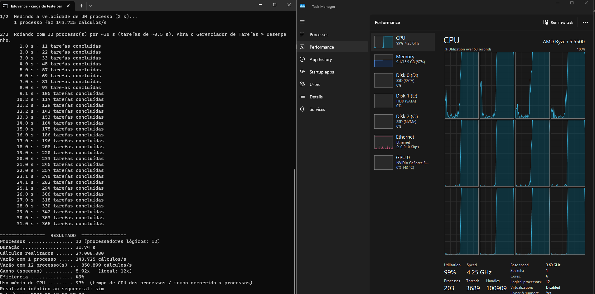

# Eduvance — Sprint 07: Executável compilado e processamento paralelo

**Entrega:** o sistema passa a ser distribuído como **executável compilado** (Nuitka) e ganha **processamento paralelo** que ocupa todos os processadores
**Repositório:** https://github.com/rafaelaragaov/Eduvance · **Turma:** 8NB
**Integrantes:** Matheus Henrique da Costa Nascimento · Rafael Aragão Vieira · José Gabriel Rocha Barreto · Gabriel do Vale Alcoforado Braga
**Grupo:** Eduvance

> O relatório em PDF (Sprints 01 a 07) é montado a partir deste conteúdo e das evidências em `docs/evidencias/sprint07/`. Só o Scrum Master o entrega.

## 1. Pedidos desta Sprint

| Pedido | Resposta | Onde |
|---|---|---|
| "O projeto não pode ser interpretado, precisa ser compilado." | O back-end (Python) é compilado para código de máquina com o **Nuitka** e entregue como `eduvance.exe`, com o front-end e o banco de demonstração dentro da pasta de distribuição. Não é preciso ter Python instalado para rodar. | seção 2 |
| "Paralelizar: todas as threads em 100% de uso." | Processamento paralelo com **um processo por thread lógica** do processador, mais uma carga de teste que mede o uso. No PC do grupo (12 threads lógicas) o uso médio de CPU ficou em **97%**. | seções 3 e 4 |
| Relatório no mesmo formato, mostrando o que foi alterado. | Este documento e o PDF consolidado (Sprints 01 a 07). | seção 5 |

Correções da Pré-Banca: continua **pendente de informação do grupo** (as observações não foram repassadas e não serão inventadas); a tabela segue no PDF, pronta para preenchimento.

## 2. Compilação com o Nuitka

**Por que Nuitka.** Ele traduz o Python para C e gera um executável nativo (modo `--standalone`: uma pasta com o `.exe` e as bibliotecas). O código continua sendo o mesmo Python, sem reescrita; o `PyInstaller` apenas empacota o interpretador, e o `Cython` exige anotar o código módulo a módulo.

**Compilador de C.** No Windows, o Nuitka precisa de um compilador de C. O MinGW64, que ele baixa sozinho, **não funciona com Python 3.13 ou mais novo**; o PC do grupo usa Python 3.14.8. Por isso o `compilar.bat` usa `--zig` (compilador Zig, baixado automaticamente para o cache do Nuitka) e, se falhar, tenta o Visual Studio.

| Item | PC do grupo |
|---|---|
| Sistema | Windows 11, 64 bits |
| Python | 3.14.8 |
| Nuitka | 4.3.1 |
| Compilador de C | Zig 0.16.0 (`--zig`) |
| Resultado | `compilado\eduvance.dist\eduvance.exe`, 25.294.336 bytes |
| Tempo | 1ª compilação: 24 min (16:35 → 16:59); seguintes: cerca de 40 s (o Zig reaproveita o que já compilou) |

Comando executado pelo `compilar.bat` (a partir da pasta `backend`):

```
python -m nuitka --standalone --assume-yes-for-downloads --output-dir=compilado --output-filename=eduvance
  --include-package=app --include-module=recomendacao --include-module=recomendacao.motor
  --nofollow-import-to=recomendacao.servico --nofollow-import-to=recomendacao.tests
  --include-data-dir=..\database=database --include-data-dir=..\frontend\dist=frontend\dist
  --noinclude-data-files=database/*.db* --zig eduvance.py
```

**Ponto de entrada único (`backend/eduvance.py`).** O mesmo arquivo roda como código-fonte (`python eduvance.py`) ou como executável (`eduvance.exe`):

| Comando | O que faz |
|---|---|
| `eduvance.exe` | sobe o sistema em http://localhost:5000 (cria o banco de demonstração se não existir) |
| `eduvance.exe --init-db [--reset]` | cria ou recria o banco |
| `eduvance.exe --benchmark-paralelo --processos auto --segundos 30` | carga de teste com todos os processadores |
| `eduvance.exe --recalcular-recomendacoes --processos auto` | recalcula, em paralelo, as recomendações de todos os alunos |
| `eduvance.exe --versao` | mostra o modo de execução (compilado ou código-fonte) |
| `--relatorio arquivo.txt` | grava em arquivo o que o modo paralelo imprime (evidência) |

**Adaptações para rodar compilado.** `config.py` detecta a execução compilada (`"__compiled__" in globals()`) e passa a procurar o banco e o front-end ao lado do `.exe`; o `multiprocessing.freeze_support()` é obrigatório no Windows para os processos filhos de um executável; o servidor web passou a ser o **waitress** (várias threads de atendimento, padrão de 4 por thread lógica, no máximo 32), com o servidor do Flask como alternativa.

## 3. Paralelismo

**Threads ou processos?** Em Python, um único processo executa **uma** linha de código Python por vez (o "GIL"), mesmo compilado. Para encher todos os processadores com cálculo é preciso **um processo por thread lógica**. A divisão ficou assim:

| Trabalho | Estratégia |
|---|---|
| Atender requisições web (esperam banco e rede) | threads (waitress) |
| Cálculo pesado (motor de recomendação) | processos (`ProcessPoolExecutor`, um por thread lógica, `os.cpu_count()`) |

**Dois modos em `backend/app/paralelo.py`:**

1. **Recálculo em lote (trabalho real):** lê os dados de cada aluno no processo principal, calcula as recomendações em paralelo (`motor.gerar`, função pura) e grava em `recomendacao_ia`. Com 110 alunos leva ~0,5 s, então aqui o custo de criar processos pesa; o modo existe para o sistema real.
2. **Carga de teste (`--benchmark-paralelo`):** repete o cálculo do motor sobre os alunos do banco até o tempo pedido, mantendo a fila de tarefas sempre cheia (nenhum processo fica ocioso). Mede a velocidade com 1 processo, a velocidade com N, o **ganho** (speedup), a **eficiência**, o **uso médio de CPU** (tempo de CPU dos processos ÷ tempo decorrido × processos) e **confere que o resultado é idêntico ao sequencial**.

## 4. Resultados no PC do grupo (AMD Ryzen 5 5500: 6 núcleos, 12 threads lógicas; `eduvance.exe` compilado)

| Medida | 1 processo (linha de base) | 12 processos |
|---|---|---|
| Cálculos por segundo | 143.725 | **850.899** |
| Ganho sobre 1 processo | 1,00x | **5,92x** |
| Uso médio de CPU | 100% | **97%** |
| Duração (meta de 10 s / 30 s) | 11,0 s | 31,7 s |
| Resultado igual ao sequencial | sim | sim |
| Cálculos realizados | 1.489.950 | 27.008.080 |

Recálculo real das recomendações de **110 alunos** com 12 processos: 0,58 s no total (leitura 0,033 s, cálculo 0,49 s, gravação 0,060 s), 112 recomendações gravadas.

**Leitura honesta dos números.**

- **Uso de CPU de 97% nas 12 threads lógicas:** é o pedido do professor ("todas as threads em 100%") atendido na prática; os ~3% restantes são o processo principal, que coordena, e o início e o fim de cada rodada.
- **Ganho de 5,92x, não 12x:** o ganho não passa de ~6x porque o processador do PC (AMD Ryzen 5 5500, conforme o Gerenciador de Tarefas) tem **6 núcleos físicos e 12 threads lógicas**: as duas threads de um núcleo (SMT) dividem a mesma unidade de cálculo. A conta reforça a leitura: em 2 processadores lógicos independentes do ambiente de desenvolvimento o ganho foi de 1,9x a 2,0x (96% a 100% de eficiência, em duas execuções).
- **Compilar não deixou o Python mais rápido neste cálculo.** No mesmo computador do ambiente de desenvolvimento, 1 processo do código-fonte fez ~111–120 mil cálculos/s e o executável compilado, ~56–70 mil. O motor mexe em texto e dicionários, onde a compilação ajuda pouco. O ganho do projeto vem de **entregar um binário** (sem interpretador instalado, sem expor o código-fonte em texto) e de **usar todos os processadores**, não da compilação por si só. Essa limitação está declarada de propósito.



## 5. O que foi alterado nesta Sprint

| Arquivo | Alteração |
|---|---|
| `backend/eduvance.py` (novo) | ponto de entrada único: sobe o sistema e roda os modos paralelos |
| `backend/app/paralelo.py` (novo) | recálculo em lote e carga de teste com `ProcessPoolExecutor` |
| `backend/app/config.py` | detecção de execução compilada e pasta-raiz ao lado do `.exe` |
| `backend/app/db.py` | `sqlite3.connect(..., timeout=15)`: espera um pouco em vez de falhar quando outro processo grava |
| `backend/app/init_db.py` | banco SQLite em modo WAL (leitura e escrita ao mesmo tempo); `--reset` também apaga `-wal` e `-shm` |
| `backend/app/services/recomendacao.py` | `gerar_e_salvar` dividida em `salvar` e `gerar_e_salvar`, para o lote calcular fora do processo principal |
| `backend/requirements.txt` | `waitress` (servidor de produção, opcional) |
| `backend/tests/test_paralelo.py` (novo) | 10 testes do paralelismo |
| `compilar.bat`, `executar_compilado.bat`, `benchmark.bat`, `verificar_compilado.bat` (novos) | compilar, abrir o sistema compilado, rodar a carga de teste e conferir o executável |
| `.gitignore`, `README.md` | arquivos de compilação ignorados; seção "Sprint 07" |

## 6. Testes

| Suíte | Resultado |
|---|---|
| Back-end (SQLite) — `python -m unittest discover -s tests` | __N_SQLITE__ |
| Back-end (PostgreSQL 16) | __N_PG__ |
| Paralelismo (`test_paralelo.py`, 10 testes) | resultado idêntico ao sequencial, 1 e 2 processos, sem banco, recálculo em lote igual ao sequencial, linha de comando |
| Navegador — roteiro da Sprint 06 contra o **executável compilado** | 54/54 |
| Carga de teste no PC do grupo (executável compilado, Windows) | resultado idêntico ao sequencial: sim |

## 7. Dificuldades e bugs desta Sprint

| Problema | Como apareceu | Solução |
|---|---|---|
| Nuitka não usa o MinGW64 com Python ≥ 3.13 | PC do grupo roda Python 3.14.8 | `--zig` (e Visual Studio como alternativa) |
| Primeira compilação parece "travada" | a saída do Nuitka vai para arquivo; o Zig compila ~190 arquivos em C | explicar no `compilar.bat`; leva 24 min na primeira vez e ~40 s depois |
| O `compilar.bat` fechava a janela ao fim | `)` sem proteção dentro de um bloco `if (...)` do Windows | texto reescrito; log do Nuitka continua válido |
| A carga de teste durava o dobro do pedido (60 s em vez de 30 s) | primeira execução no PC: o número de tarefas era calculado supondo ganho perfeito | a fila agora é reposta até o tempo acabar (31,7 s para a meta de 30 s) |
| Executável compilado sem o banco de demonstração | a etapa final do `compilar.bat` não rodava | `benchmark.bat` cria o banco sozinho (`--init-db --reset`) |
| Compilar não acelerou o cálculo | medição na mesma máquina (seção 4) | resultado registrado; o ganho vem do paralelismo |

## 8. Limitações

- Ganho de ~6x em 12 threads lógicas: o Ryzen 5 5500 do PC tem 6 núcleos físicos (SMT); com mais núcleos físicos o ganho seria maior.
- Com 110 alunos o recálculo em lote leva 0,5 s: o paralelismo só se paga com volumes maiores; por isso existe a carga de teste.
- O executável é gerado por `compilar.bat` (Nuitka + Zig); ele não é versionado no Git (`compilado/` no `.gitignore`).
- O front-end continua sendo servido por arquivos estáticos; só o back-end é compilado.

## 9. Próximos passos

Fechar as pendências da Pré-Banca; preencher `docs/CONTRIBUICOES.md` e adotar branches e Pull Requests; medir a carga com o PostgreSQL gerenciado; mensalidades (PB20), horários (PB22), chat (PB24); publicação em servidor e integração contínua com `typecheck`, testes e compilação a cada Pull Request.

## 10. Como executar

```bat
compilar.bat             :: gera compilado\eduvance.dist\eduvance.exe (e docs\evidencias\sprint07\compilacao_pc.txt)
executar_compilado.bat   :: abre o sistema compilado em http://localhost:5000
benchmark.bat            :: carga de teste: 1 processo e todos os processadores (use o Gerenciador de Tarefas)
```
